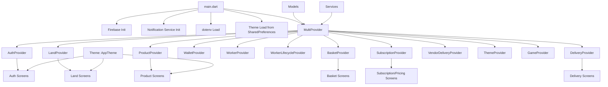

# Farmy 🌱  
**A cross-platform digital agriculture platform connecting farmers, investors, and buyers.**

[](https://flutter.dev)
[](https://dart.dev)
[]()
[]()

---

## Table of Contents
- [1. Executive Summary](#1-executive-summary)
- [2. Vision & Business Context](#2-vision--business-context)
- [3. Product Capabilities](#3-product-capabilities)
- [4. Technical Architecture](#4-technical-architecture)
- [5. Repository Structure](#5-repository-structure)
- [6. Tech Stack](#6-tech-stack)
- [7. Getting Started](#7-getting-started)
- [8. Configuration](#8-configuration)
- [9. Build & Release](#9-build--release)
- [10. Quality & Testing](#10-quality--testing)
- [11. Security Practices](#11-security-practices)
- [12. Contribution Guidelines](#12-contribution-guidelines)
- [13. Roadmap](#13-roadmap)
- [14. Maintainer](#14-maintainer)
- [15. License](#15-license)

---

## 1. Executive Summary

FarmyApp is a modern agritech application built with Flutter to digitize and connect core agricultural workflows.  
The platform is designed to serve multiple actors in one ecosystem:

- **Farmers** (operations, monetization, land/product visibility)
- **Investors** (transparency, trust, proof-driven validation)
- **Buyers/Customers** (market access and purchase experience)

FarmyApp combines product marketplace mechanics, land/rental domain logic, verification workflows, and financial modules into one scalable mobile-first architecture.

---

## 2. Vision & Business Context

### Problem
Agriculture workflows are often fragmented across disconnected tools and manual processes:
- Limited transparency between capital and field operations
- Weak trust signals for remote investors
- Inefficient market access for producers
- Complex coordination around delivery and fulfillment

### Solution
FarmyApp provides a unified experience that supports:
- Identity and account lifecycle
- Land and rental workflows
- Product listing and basket-based commerce
- Subscription and payment integrations
- Delivery and vendor-delivery operations
- Proof request lifecycle for trust/compliance support

### Strategic Value
- Multi-role platform architecture
- Strong foundation for monetization (subscriptions, transactions, premium workflows)
- Cross-platform codebase for faster product evolution

---

## 3. Product Capabilities

> Based on current repository modules, providers, models, and screen structure.

### User & Access
- Sign up / login / forgot password / reset password
- Verification and 2FA-oriented flows
- Access control states (e.g., banned/no-internet screens)

### Land & Farming Domain
- Land modeling (geometry, dimensions, pricing, boundaries)
- Rental lifecycle logic
- Ownership and activity status management

### Commerce
- Product domain and listing flows
- Basket/cart management
- Quantity/stock-aware item logic

### Financial & Subscription
- Wallet module
- Subscription and mandatory pricing flows
- Stripe integration points

### Delivery
- Delivery and vendor delivery providers
- Fulfillment-related state orchestration

### Verification / Trust Layer
- Camera + ML/vision-enabled verification capabilities
- Proof request model lifecycle:
  - `pending`
  - `verified`
  - `rejected`
  - `expired`

### Experience & UX
- Light / dark / system theming
- Material 3 style foundation
- Shared preferences-based theme persistence

---

## 4. Technical Architecture

FarmyApp follows a modular architecture with Provider-driven state management.

### Layers

- **Presentation Layer**
  - `lib/screens/`
  - `lib/widgets/`

- **State Management Layer**
  - `lib/providers/` (`ChangeNotifier` + `Provider`)

- **Domain Layer**
  - `lib/models/`

- **Service Layer**
  - `lib/services/`

- **Cross-Cutting**
  - `lib/theme/`
  - `lib/utils/`
  - env + startup bootstrapping in `lib/main.dart`

### App Bootstrap (`lib/main.dart`)

On startup, the app:
1. Initializes Flutter bindings
2. Initializes Firebase with generated platform options
3. Initializes push notifications
4. Loads `.env`
5. Loads persisted theme mode
6. Registers all core providers with `MultiProvider`

### Architecture Diagram



---

## 5. Repository Structure

```text
farmyapp/
├── android/
├── ios/
├── web/
├── windows/
├── linux/
├── macos/
├── assets/
├── plugins/
├── test/
├── lib/
│   ├── main.dart
│   ├── firebase_options.dart
│   ├── models/
│   ├── providers/
│   ├── screens/
│   ├── services/
│   ├── theme/
│   ├── utils/
│   └── widgets/
├── pubspec.yaml
├── pubspec.lock
├── .env.example
├── firebase.json
├── analysis_options.yaml
└── README.md
```

---

## 6. Tech Stack

### Core
- Flutter
- Dart (`sdk: ^3.10.3`)
- Provider

### Integrations & Libraries
- Firebase Core
- Google Sign-In
- HTTP
- Dotenv
- Secure Storage
- Flutter Web Auth
- Shared Preferences
- Flutter Map + LatLong
- Camera + ML Kit + Vision libraries
- Stripe
- Image/File picker utilities
- Intl / URL launcher / QR / shimmer

---

## 7. Getting Started

## Prerequisites
- Flutter SDK installed
- Dart SDK (bundled with Flutter)
- Android Studio and/or Xcode
- A configured Firebase project for target platforms

## Installation

```bash
git clone https://github.com/fekikarim/farmyapp.git
cd farmyapp
flutter pub get
```

## Environment Setup

```bash
cp .env.example .env
```

Then populate `.env` with your runtime configuration values.

## Run Locally

```bash
flutter run
```

---

## 8. Configuration

### Firebase
- `lib/firebase_options.dart` is generated by FlutterFire CLI.
- If project credentials/platform setup changes, regenerate and commit updated options safely.

### iOS Notes
- Verify URL schemes and auth config in `ios/Runner/Info.plist`.
- Ensure camera/microphone permissions are aligned with actual in-app behavior.

### Android Notes
- Confirm package identifiers, signing configs, and release settings before production builds.

---

## 9. Build & Release

### Android
```bash
flutter build apk --release
flutter build appbundle --release
```

### iOS
```bash
flutter build ios --release
```

### Web
```bash
flutter build web
```

---

## 10. Quality & Testing

### Baseline Checks
```bash
flutter analyze
flutter test
```

### Recommended Engineering Enhancements
- Add widget tests for critical user journeys
- Add integration tests for:
  - auth lifecycle
  - basket/checkout flows
  - verification workflows
- Add CI pipeline with mandatory quality gates

---

## 11. Security Practices

- Keep secrets out of source code
- Store sensitive runtime values in `.env` / CI secret managers
- Use secure local token storage
- Rotate credentials periodically
- Enforce backend authorization checks for protected resources
- Review mobile permissions to match functional necessity

---

## 12. Contribution Guidelines

1. Fork and branch from `main`
2. Keep changes scoped and domain-focused
3. Follow existing coding style and architecture patterns
4. Run `flutter analyze` and `flutter test` before pushing
5. Open a PR with:
   - summary
   - motivation
   - screenshots/videos (if UI changes)
   - testing notes

---

## 13. Roadmap

- [ ] Expand architecture docs per domain/provider
- [ ] Add API contract documentation
- [ ] Add CI/CD for multi-platform delivery
- [ ] Strengthen observability (crash/error + analytics)
- [ ] Improve accessibility and localization coverage
- [ ] Add production release checklist and runbooks

---

## 14. Maintainer

- **Repository:** `fekikarim/farmyapp`
- **Developers:** `@fekikarim`, `@nesrine77`, `@HamaBTW`, `@oussemissaoui`, `@fatmahidouss`

---

## 15. License

This project is licensed under the **MIT License**.  
See the [LICENSE](./LICENSE) file for details.
