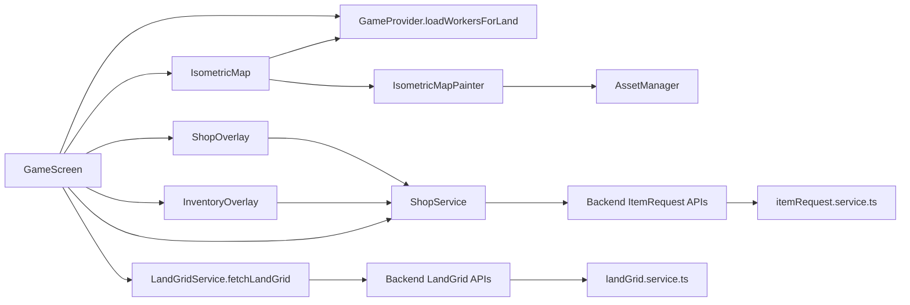

# Farmy Game Design System

A technical design reference for how the current game is built across the Flutter client and backend gameplay services.

## Table of Contents
- [1. Purpose](#1-purpose)
- [2. Scope and Boundaries](#2-scope-and-boundaries)
- [3. Source of Truth](#3-source-of-truth)
- [4. System Architecture](#4-system-architecture)
- [5. Gameplay Runtime Loops](#5-gameplay-runtime-loops)
- [6. Rendering and Spatial Rules](#6-rendering-and-spatial-rules)
- [7. State Management and Persistence](#7-state-management-and-persistence)
- [8. Data Contracts](#8-data-contracts)
- [9. Asset and Animation Pipeline](#9-asset-and-animation-pipeline)
- [10. UI Surfaces and Responsibilities](#10-ui-surfaces-and-responsibilities)
- [11. Backend Integration Map](#11-backend-integration-map)
- [12. Extension Playbook](#12-extension-playbook)
- [13. Risks and Design Constraints](#13-risks-and-design-constraints)
- [14. Enhancement Testing Matrix](#14-enhancement-testing-matrix)
- [15. Glossary](#15-glossary)
- [16. Maintenance Checklist](#16-maintenance-checklist)

## 1. Purpose

This document explains exactly how the game is currently designed and implemented so future enhancements can be planned without re-discovering hidden behavior.

Goals:
- Provide one canonical design reference for gameplay architecture.
- Map all important gameplay behavior to concrete code locations.
- Document contracts between frontend gameplay and backend game APIs.
- Identify extension points and known constraints before adding new mechanics.

## 2. Scope and Boundaries

In scope:
- Flutter game module in `lib/game`.
- Gameplay state in `lib/providers/game_provider.dart`.
- Gameplay-facing models and services (`shop_item_model.dart`, `shop_service.dart`, `land_grid_service.dart`).
- Backend gameplay contracts and lifecycle logic (`landGrid.service.ts`, `itemRequest.service.ts`, related controller/model enums).

Out of scope:
- Non-game app areas not directly coupled to gameplay.
- Generic UI pages unrelated to map, shop, inventory, or item lifecycle.

## 3. Source of Truth

Primary frontend files:
- `lib/game/game_screen.dart`
- `lib/game/isometric_map.dart`
- `lib/game/asset_manager.dart`
- `lib/game/shop_overlay.dart`
- `lib/game/inventory_overlay.dart`
- `lib/game/land_grid_service.dart`
- `lib/providers/game_provider.dart`
- `lib/models/shop_item_model.dart`
- `lib/services/shop_service.dart`

Primary backend files:
- `../farmy-backend/src/models/AssetCategory.ts`
- `../farmy-backend/src/controllers/v1/landGrid.controller.ts`
- `../farmy-backend/src/services/v1/landGrid.service.ts`
- `../farmy-backend/src/services/v1/itemRequest.service.ts`
- `../farmy-backend/docs/GRID_SYSTEM.md`

## 4. System Architecture

### 4.1 Layered Design

Client gameplay is organized as:
- Orchestration Layer: `GameScreen`
- Rendering Layer: `IsometricMap` + `IsometricMapPainter`
- State Layer: `GameProvider` (`WorkerState` list and runtime movement)
- Asset Layer: `AssetManager` singleton (sprite loading/cache/frame discovery)
- Interaction Overlays: `ShopOverlay`, `InventoryOverlay`
- Network Layer: `ShopService`, `LandGridService` (authenticated API requests)

Backend gameplay shape is provided by:
- Grid assembly and footprint computation (`LandGridService`)
- Item request lifecycle (`ItemRequestService`)
- Category and lifecycle enums (`AssetCategory`, `ItemRequestStatus`, `ItemRequestType`)

### 4.2 Architecture Diagram



## 5. Gameplay Runtime Loops

### 5.1 Startup and Initialization Loop

1. `GameScreen._initializeApp()` runs after first frame.
2. Executes in parallel:
- `LandGridService.fetchLandGrid(landId)`
- `_precacheAssets()` for static textures/fences/trees
- rental fetch for investor role
3. On success:
- stores `_gridData`
- sets loading complete
- calls `gameProvider.loadWorkersForLand()` with grid dimensions
4. `IsometricMap` receives matrix and workers, then paints map continuously via animation controller.

### 5.2 Placement Loop

1. User chooses item from inventory.
2. `GameScreen._startPlacement(item)` enables placement mode.
3. Client requests footprint: `ShopService.getAssetFootprint(category, variantId)`.
4. User taps tile; `_onMapTap(x, y)` updates pending tile and validity.
5. `_validatePlacement()` checks:
- footprint cells in bounds
- no occupied matrix cells
6. On confirm, `ShopService.buyItem(...)` creates request and exits placement mode.

### 5.3 Purchase and Approval Loop

1. Shop loads categories and types via `ShopService.getAssetTypes(...)`.
2. Variant details fetched via `ShopService.getAssetTypeWithVariants(...)`.
3. Purchase posts to `POST /api/v1/item-requests`.
4. Backend creates pending BUY request.
5. Approve path:
- request status becomes APPROVED
- item becomes available for placement/inventory flow
6. Placement path:
- `POST /item-requests/:id/place` creates inactive placed item and a new PLACEMENT request
- PLACEMENT approval activates the placed item (`is_active = true`)

### 5.4 Item Interaction and Worker Dispatch Loop

1. Tap item sprite hitbox opens radial menu.
2. Available actions are currently:
- `info`
- `collect` (for category `animal` or `tree`)
3. `collect` computes item center using origin + footprint and calls `moveClosestWorkerTo(...)`.
4. `WorkerState.moveTo(...)` animates toward target with periodic timer.

## 6. Rendering and Spatial Rules

### 6.1 Isometric Coordinate Transform

Constants:
- `tileWidth = 64.0`
- `tileHeight = 32.0`

Forward transform (grid to screen):
- `isoX = (x - y) * (tileWidth / 2) + offsetX`
- `isoY = (x + y) * (tileHeight / 2) + offsetY`

Map origin offsets are computed inside `IsometricMap` and painter (`offsetX`, `offsetY`).

### 6.2 Layering and Depth Order

Painter creates task lists each frame:
- ground tasks
- object tasks (items, fences, trees, workers)

Sort rule:
- depth key is `x + y`
- workers use `workerDepth = worker.x + worker.y`
- tie-breaker by `x`

This is the current z-order strategy for isometric overlap.

### 6.3 Item Hit Testing

Tap handling performs screen-space bounding-box hit testing for sprites before tile conversion.
- Iterates front-to-back to prioritize foreground elements.
- Uses sprite dimensions when loaded; falls back to estimated aspect ratio.

### 6.4 Placement Overlay

When placement mode is active and footprint is available:
- footprint cells render green for valid
- render red for occupied or out-of-bounds
- ghost item is previewed at selected tile

## 7. State Management and Persistence

### 7.1 Runtime State Ownership

`GameProvider` owns worker runtime state:
- list of `WorkerState`
- movement targets, direction, animation status
- loading status flags

`GameScreen` owns local orchestration state:
- `_gridData`
- loading status
- placement mode, selected placement item, pending coordinates

### 7.2 Persistence Rules

Persisted:
- `enable_edge_panel` in shared preferences

Not persisted:
- worker positions and movement path progress
- active map selection and radial menu state

### 7.3 Update Propagation

- provider mutation calls `notifyListeners()`
- `IsometricMap` reads provider and repaints
- painter animation controller continuously updates frame-based rendering

## 8. Data Contracts

### 8.1 Grid Response Contract

`GET /api/v1/land-grid/:id/grid` returns:

```json
{
  "land_id": "uuid",
  "grid_width": 10,
  "grid_height": 10,
  "matrix": [
    [
      null,
      {
        "id": "placed_item_uuid",
        "category": "animal",
        "variant_id": "variant_uuid",
        "variant_code": "cow_v1",
        "state": { "status": "idle" },
        "sprites": { "idle": "3d/animals/cow/idle" },
        "is_active": true,
        "origin_x": 1,
        "origin_y": 1,
        "is_origin": true,
        "footprint_width": 2,
        "footprint_height": 2
      }
    ]
  ]
}
```

Notes:
- matrix cells are currently dynamic maps in frontend code.
- each occupied cell may contain repeated item metadata across footprint cells.

### 8.2 Footprint Contract

`GET /api/v1/land-grid/assets/:category/variants/:id/footprint?rotation=n`

Expected payload:

```json
{
  "variant_id": "uuid",
  "category": "animal",
  "base_size": { "width": 2, "height": 2 },
  "rotation": 0,
  "squares": [
    { "x": 0, "y": 0 },
    { "x": 1, "y": 0 }
  ]
}
```

### 8.3 Request Lifecycle Contract

Enums:
- `ItemRequestStatus`: `pending | approved | rejected`
- `ItemRequestType`: `buy | placement`

Lifecycle behavior:
- BUY request starts as pending and can be approved/rejected.
- Placing an approved buy item creates:
  - inactive `PlacedItem`
  - new pending PLACEMENT request (linked by `parent_id`)
- approving PLACEMENT activates linked placed item.

### 8.4 Shop Models

`ShopItemType` fields:
- `id`, `name`, `description`, `icon_url`, `is_active`, optional `variants`

`ShopItemVariant` fields:
- `id`, `type_id`, `variant_code`, `base_price`, `attributes`, `image_url`, `sprites`, `is_available`

## 9. Asset and Animation Pipeline

### 9.1 Path Conventions

`AssetManager` normalizes paths:
- strips leading `/`
- prepends `assets/game_images/` when path is not absolute under `assets/`

Sprite roots are variant-provided (`sprites` map), then converted to frame paths.

### 9.2 Frame Naming Support

Two frame patterns are supported:
- standard: `image0.png`, `image1.png`, ...
- padded: `image000.png`, `image001.png`, ...

Pattern is detected per path and cached.

### 9.3 Caching and Discovery

`AssetManager` caches:
- decoded images
- frame count per base path
- detected naming pattern

Fallback discovery checks bundle existence frame-by-frame (up to 100) when manifest data is missing.

### 9.4 Animation Selection Rules

- item animation status is read from `item.state.status` with idle fallback
- worker sprite direction is selected from worker runtime direction
- missing or unavailable frames can result in non-rendered sprites (no hard error UI)

## 10. UI Surfaces and Responsibilities

### 10.1 GameScreen

Responsibilities:
- initializes game context
- manages placement mode and item action handlers
- opens overlays and informational sheets
- coordinates services/providers/map widget

### 10.2 IsometricMap

Responsibilities:
- pan/zoom container
- gesture handling (tap, double tap)
- item menu trigger and tile selection
- delegates all drawing to painter

### 10.3 ShopOverlay

Responsibilities:
- category tabs and item type browsing
- variant detail loading
- initiates buy flow with wallet/payment constraints

### 10.4 InventoryOverlay

Responsibilities:
- inventory retrieval by selected rented land
- status filters: ALL, PENDING, APPROVED, REJECTED
- launch placement for eligible inventory items

## 11. Backend Integration Map

Gameplay-critical client endpoints:
- `GET /api/v1/land-grid/:id/grid`
- `GET /api/v1/land-grid/assets/:category/variants/:id/footprint`
- `POST /api/v1/item-requests`
- `POST /api/v1/item-requests/:id/approve`
- `POST /api/v1/item-requests/:id/reject`
- `POST /api/v1/item-requests/:id/place`
- `GET /api/v1/item-requests/investor/inventory`

Server-side gameplay logic highlights:
- grid matrix is assembled from `placed_items` + variant size/rotation footprint.
- request approval can trigger placement activation.
- ownership/rental permissions are enforced before create/place operations.
- payment can use credits or Stripe saved card path.

## 12. Extension Playbook

### 12.1 Add a New Asset Category

1. Add enum value in backend `AssetCategory`.
2. Implement backend type/variant endpoints for category.
3. Ensure variants expose `attributes`, `sprites`, `image_url` shape.
4. Add category to frontend `AssetCategory` enum in `shop_service.dart`.
5. Validate tab rendering and category mapping in `ShopOverlay`.
6. Add category-specific radial actions if needed in `IsometricMap._getActionsFor`.

### 12.2 Add a New Item Action

1. Add action metadata in radial menu builder.
2. Handle action in `GameScreen._onItemAction`.
3. If backend interaction required, add service method in `ShopService` or dedicated gameplay service.
4. Define visual response and completion feedback pattern (snackbar/modal).

### 12.3 Add New Item State Animation

1. Add new status key in backend item `state` payload.
2. Provide matching sprite path under variant `sprites` map.
3. Confirm fallback path for unknown states.
4. Add QA case for missing frames and missing status.

### 12.4 Add Real-Time Sync

Current status:
- frontend has socket service infrastructure but gameplay map updates are request-refresh based.

Recommended event model:
- `grid_updated`
- `item_placed`
- `item_state_changed`
- `worker_assigned`

Integration approach:
1. subscribe in gameplay entry screen
2. patch local matrix/provider state incrementally
3. debounce full-grid refetch as consistency fallback

### 12.5 Add Rotation UI Support

Backend already supports rotation in footprint calculation and placement API.
To expose it in client:
1. store pending rotation in `GameScreen` placement state
2. request footprint with `rotation` query
3. update preview overlay based on selected rotation
4. send rotation in place/buy request flow

## 13. Risks and Design Constraints

1. Untyped matrix cells in frontend increase contract fragility.
2. Rendering constants are hardcoded in multiple places.
3. Depth sorting runs every frame and can become expensive with larger maps.
4. Worker pathing is nearest-worker dispatch with simple interpolation, not obstacle-aware pathfinding.
5. Sprite missing-frame handling is soft-fail and can hide content defects.
6. Gameplay state is split between local widget state and provider state.
7. Placement flow includes multi-request lifecycle (BUY and PLACEMENT) that is easy to misuse without clear UI labels.

## 14. Enhancement Testing Matrix

When adding or changing game mechanics, validate at minimum:

1. Placement correctness
- in-bounds footprint
- out-of-bounds rejection
- occupied cell rejection
- rotation edge positions

2. Rendering correctness
- item layering and overlap
- worker and item animation frame selection
- hitbox accuracy across different footprint sizes

3. API contract stability
- required fields present in grid matrix cells
- enum/value casing compatibility
- lifecycle transitions (pending -> approved/rejected)

4. Payment and approval behavior
- credit purchase success/failure
- payment method path success/failure
- approval and rejection side effects (activation/refund)

5. Resilience
- network failure during initialization
- stale inventory vs grid states
- missing sprite assets

## 15. Glossary

- Grid cell: one matrix coordinate `(x, y)` on a land.
- Footprint: all grid cells occupied by one asset variant at a given rotation.
- Origin cell: primary anchor `(position_x, position_y)` for an item.
- BUY request: acquisition request for item ownership/availability.
- PLACEMENT request: approval step to activate an item at a map position.
- Active item: placed item allowed to participate in gameplay rendering/logic.

## 16. Maintenance Checklist

Use this checklist whenever gameplay code changes:

1. Update this document sections touched by code change.
2. Verify endpoints and payload examples still match live API.
3. Verify enums and statuses still match backend model definitions.
4. Re-check extension playbook if new category/action/state was added.
5. Add new known constraints or remove resolved ones.

---

Last validated against repository state on 2026-04-04.
